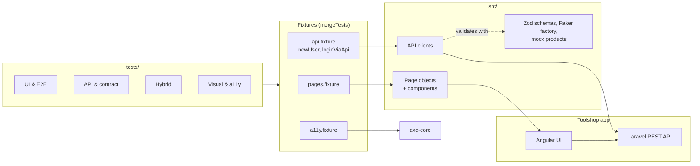
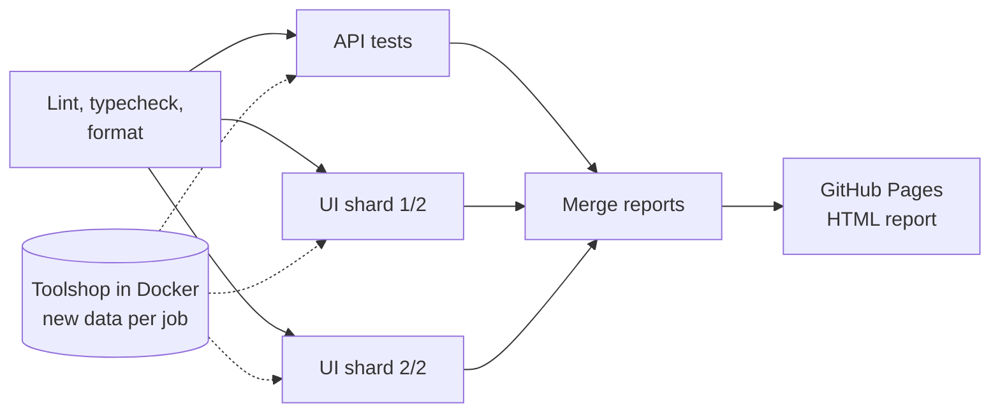

# Playwright tests for the Toolshop demo app

[](https://github.com/Manimaran3101/playwright-enterprise-framework/actions/workflows/ci.yml)
[](https://manimaran3101.github.io/playwright-enterprise-framework/)


[](LICENSE)

This is my UI and API test project with Playwright and TypeScript. It tests the
[Practice Software Testing "Toolshop"](https://practicesoftwaretesting.com) web shop.

The latest test report is on [GitHub Pages](https://manimaran3101.github.io/playwright-enterprise-framework/).
CI updates it on every push to `main` and every night.


The GIF is the E2E checkout test (recorded with `npm run demo:record`). The user and the
final check go through the API. Only the shopping steps run in the browser.

I built this with help from an AI assistant. I made the design choices, ran and debugged the
tests, and can explain all of it.

## What is in the project

- 34 tests: E2E, UI, API, contract, hybrid, mocked network, visual and accessibility.
  With all browsers (Chromium, Firefox, WebKit, mobile Chrome) this is 89 test runs.
- Most tests create their data with the API and only use the browser for the part they test.
  Only the login and sign-out tests use the UI login form.
- API responses are checked with Zod schemas. The TypeScript types are made from the same
  schemas.
- In CI every job starts its own copy of the app in Docker. UI tests run in 2 shards and the
  reports are merged into one HTML report.
- I found 3 bugs in the app and one problem with the shared demo account
  ([details](#bugs-i-found)).

## Architecture



A test only lists what it needs, for example `async ({ checkoutPage, invoicesApi, newUser })`,
and the fixtures create it. Page objects only click and type. All assertions are in the tests.

The checkout test in the GIF works like this:

1. Register a user and log in with the API, get a JWT.
2. Put the JWT in `localStorage`, so the browser is logged in.
3. Find a product that is in stock with the API.
4. In the browser: add to cart, go through the 4 checkout steps, pay.
5. The confirmation page shows an invoice number (`INV-xxxx`).
6. Get `/invoices` from the API and check that the invoice total is price × quantity.

## Test suites

| Suite           | Tag           | Tests | What it checks                                                             |
| --------------- | ------------- | ----: | -------------------------------------------------------------------------- |
| UI E2E          | `@e2e`        |     1 | Full checkout: cart, sign-in, billing, payment, invoice checked in the API |
| UI functional   | `@regression` |     6 | Register, login, wrong password, sign out, saved session, cart totals      |
| API functional  | `@regression` |     4 | Register, login, `/users/me`, duplicate email (409), 401 cases             |
| API contract    | `@contract`   |     7 | Real API responses checked against the Zod schemas                         |
| Hybrid          | `@hybrid`     |     2 | Data created in the API shows in the UI; a change in the UI is saved       |
| Network mocking | `@mocked`     |     4 | Empty product list, exact rendering, very long values, HTTP 500            |
| Visual          | `@visual`     |     2 | Screenshots of the login form and product grid (mocked data)               |
| Accessibility   | `@a11y`       |     3 | No new critical or serious WCAG 2.1 AA issues on 3 pages                   |
| Smoke           | `@smoke`      |     5 | Quick check that the UI and API work                                       |

Smoke is a tag on tests from other suites, so the total is 34, not 39.

## CI



The public site shows a Cloudflare bot check to GitHub runners. I did not try to get around
it. Instead, the [`start-toolshop`](.github/actions/start-toolshop/action.yml) action starts the
app (Laravel API, Angular UI, MariaDB) inside every job, from a fixed commit, with fresh seed
data. This is also faster, and the data is the same every run.

The UI tests run inside Microsoft's Playwright Docker image, which has the browsers already
installed. Before, I installed them with apt on the runner, and one runner had a very slow
mirror that timed out every time. Docker pulls are retried a few times because Docker Hub
sometimes returned 502.

Pull requests and pushes run Chromium only. The nightly run uses all 4 browser projects.
The shard reports are merged into one HTML report with traces, also when tests fail.
Visual baselines for Linux are made by [`update-snapshots.yml`](.github/workflows/update-snapshots.yml)
in the same image and app version as CI. Dependabot updates npm packages and GitHub Actions.

## Bugs I found

Each one has a test that is marked `test.fail()` or listed as a known issue. These tests pass
while the bug is there and fail when it is fixed, so I notice the fix.

| #   | What I found                                                                              | Test                                                          |
| --- | ----------------------------------------------------------------------------------------- | ------------------------------------------------------------- |
| 1   | When `/products` returns HTTP 500, the page shows an empty grid with no error message     | [`network-mocking.spec.ts`](tests/ui/network-mocking.spec.ts) |
| 2   | `/products/search` returns products without `category.slug`, but `/products` has it       | [`contract.api.spec.ts`](tests/api/contract.api.spec.ts)      |
| 3   | Accessibility: a button without a name (critical), label/name mismatch, wrong list markup | [`known-issues.ts`](tests/accessibility/known-issues.ts)      |
| 4   | Not an app bug: the shared demo account gets locked by other people's failed logins       | [`auth.setup.ts`](tests/auth.setup.ts)                        |

Number 4 is the reason my tests create their own users.

## Why I did it this way

- **New user for each run.** The public demo accounts get locked. With my own users the tests
  don't depend on each other and can run in parallel.
- **Login with the API in `auth.setup.ts`.** Logging in through the UI in every test is slow.
  The setup project logs in once with the API, puts the JWT in `localStorage` and saves the
  `storageState`.
- **Own user for tests that sign out.** Signing out can make the token invalid. If a test did
  that with the shared saved session, other tests running at the same time would break.
- **No hard-coded IDs.** The demo database is reset and the product IDs change, so tests find
  a product with the API (`firstPurchasable()`).
- **`@step` decorator.** Page and API methods show as named steps in the report and trace.
- **Schemas are not strict.** A new field in the API is fine. A missing field or a wrong type
  fails the test.
- **The API checks the UI.** Search results are compared with `/products/search`, and the
  checkout total with `/invoices`.
- **Visual tests use mocked data.** Real data changes, so I mock the products and mask the
  images. Baselines are only for Chromium.
- **Accessibility baseline.** Issues that already exist are listed in `known-issues.ts`. A new
  critical or serious issue fails the test.
- **API timeout 30s.** The public demo API sometimes takes more than 20s to answer the first
  call. UI actions keep 10s.
- **Cash on delivery.** The checkout test never types card or bank details, not even fake ones.

## Run it

You need Node.js 20 or newer (see [`.nvmrc`](.nvmrc)).

```bash
npm ci
npx playwright install chromium
cp .env.example .env
```

| Command                      | What it does                                  |
| ---------------------------- | --------------------------------------------- |
| `npm run test:chromium`      | All UI tests in Chromium                      |
| `npm run test:api`           | API tests (no browser)                        |
| `npm run test:smoke`         | Tests tagged `@smoke`                         |
| `npm run test:e2e`           | The E2E checkout test                         |
| `npm run test:a11y`          | Accessibility scans                           |
| `npm run test:visual:update` | Make new visual baselines for your OS         |
| `npm run report`             | Open the last HTML report                     |
| `npm run demo:record`        | Record the README GIF again                   |
| `npm run lint` / `typecheck` | Static checks (the pre-commit hook runs them) |

You can run any tag with `npx playwright test --grep @tag`. Locally the tests use the public
demo (`TEST_ENV=prod`). Set `TEST_ENV=local` if you run the app yourself with Docker.

## Folders

```
src/
├── config/        environment presets, auth file paths
├── pages/         page objects (BasePage, pages, checkout)
│   └── components/  header, product grid
├── api/           API clients (auth, products, cart, invoices)
├── data/
│   ├── schemas.ts   Zod schemas for the API responses (types are made from them)
│   ├── factories/   Faker user builder
│   └── mocks/       fixed products for mocked and visual tests
├── fixtures/      pages / api / a11y fixtures, custom matcher
└── utils/         @step decorator, API route matcher
tests/
├── auth.setup.ts  registers a user and saves the logged-in session once
├── ui/            browser tests (checkout, auth, cart, network mocking)
├── api/           API tests and contract tests
├── hybrid/        API + UI tests
├── visual/        screenshot tests and baselines
└── accessibility/ axe-core scans and known issues
scripts/demo/      records the README GIF
.github/           CI, baseline workflow, start-toolshop action, Dependabot
```

## License

[MIT](LICENSE) © Manimaran Murugan
