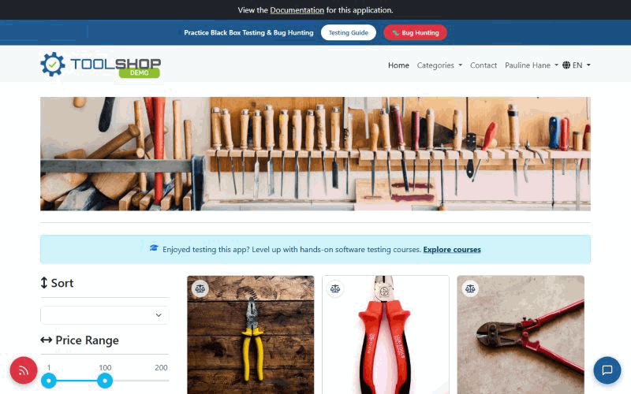
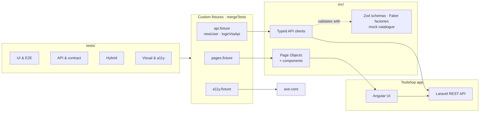
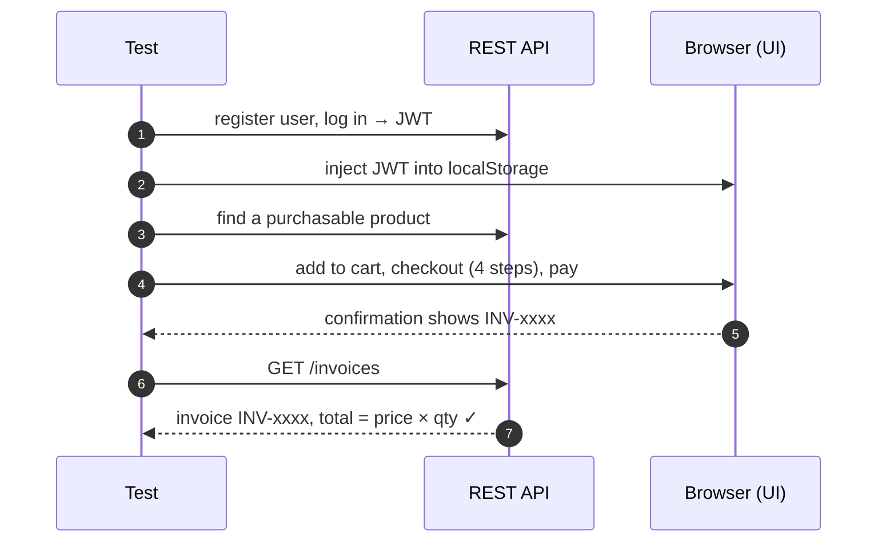
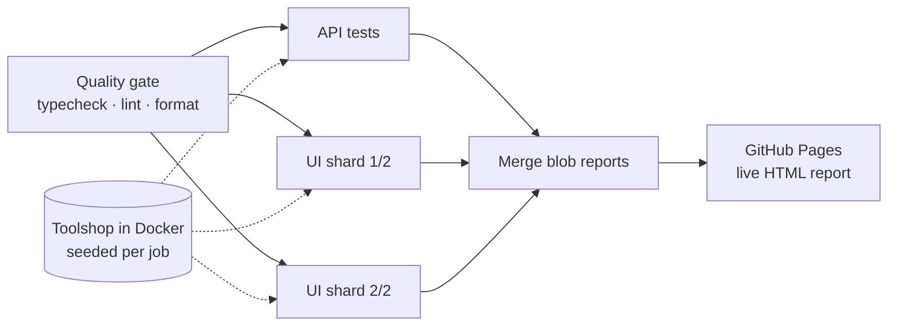

# Playwright Enterprise Framework

[](https://github.com/Manimaran3101/playwright-enterprise-framework/actions/workflows/ci.yml)
[](https://manimaran3101.github.io/playwright-enterprise-framework/)


[](LICENSE)

A production-style **UI + API test automation framework** built with Playwright and TypeScript, testing the [Practice Software Testing "Toolshop"](https://practicesoftwaretesting.com) e-commerce app.

**📊 [Live test report](https://manimaran3101.github.io/playwright-enterprise-framework/)** · published by CI on every push to `main` and nightly



<sub>The E2E checkout test, recorded with `npm run demo:record`. Setup and verification happen through the API; only the user journey runs in the browser.</sub>

## Highlights

- **34 tests across 8 suites** — E2E, functional UI, API, contract, hybrid, network-mocked, visual and accessibility — running as **89 test runs** across Chromium, Firefox, WebKit and mobile.
- **Hybrid architecture** — arrange through the API, act in the UI, assert in both. Tests are fast and independent, and never log in through the UI unless that's what they test.
- **Contract testing with Zod** — response types are inferred from the schemas, so code and contract checks can't drift apart.
- **Hermetic CI** — every GitHub Actions job starts its own seeded copy of the app in Docker; tests are sharded and the reports merged into one published HTML report.
- **Found 4 real defects** in the application under test, documented as tracked, expected-to-fail tests ([details](#findings-in-the-application-under-test)).

## Contents

[Architecture](#architecture) · [Test coverage](#test-coverage) · [CI/CD pipeline](#cicd-pipeline) · [Findings](#findings-in-the-application-under-test) · [Design decisions](#design-decisions) · [Getting started](#getting-started) · [Project structure](#project-structure)

## Architecture



Tests only declare what they need — `async ({ checkoutPage, invoicesApi, newUser }) => …` — and the fixtures build it. Page Objects describe _how_ to interact; tests own _what_ is expected.

**How a hybrid test flows** (the checkout test in the GIF above):



## Test coverage

| Suite           | Tag           | Tests | What it proves                                                                       |
| --------------- | ------------- | ----: | ------------------------------------------------------------------------------------ |
| UI E2E          | `@e2e`        |     1 | Full checkout: cart → sign-in → billing → payment → invoice, verified in the backend |
| UI functional   | `@regression` |     6 | Register, login, wrong password, sign out, saved session, cart totals                |
| API functional  | `@regression` |     4 | Register → login → `/users/me`, duplicate email (409), 401 cases                     |
| API contract    | `@contract`   |     7 | Live responses validated against Zod schemas                                         |
| Hybrid          | `@hybrid`     |     2 | API-created data shows in the UI; UI changes are persisted in the API                |
| Network mocking | `@mocked`     |     4 | Empty catalogue, exact rendering, extreme values, HTTP 500 handling                  |
| Visual          | `@visual`     |     2 | Login form and product grid screenshots (mocked data, masked images)                 |
| Accessibility   | `@a11y`       |     3 | No _new_ critical/serious WCAG 2.1 AA violations on key pages                        |
| Smoke           | `@smoke`      |     5 | Fast health check of UI and API                                                      |

## CI/CD pipeline



- **Hermetic test environment** — [`start-toolshop`](.github/actions/start-toolshop/action.yml) runs the app (Laravel API, Angular UI, MariaDB) inside every job, pinned to a commit and freshly seeded. The public demo sits behind a Cloudflare bot check that challenges CI runners; testing a private instance avoids it _without_ trying to bypass it, and removes cold starts and shared data.
- **Pinned browser environment** — UI tests run inside the official `mcr.microsoft.com/playwright` image matching the installed Playwright version, so no job depends on apt mirrors; flaky infrastructure steps (Docker Hub pulls) retry with backoff.
- **Fast PRs, thorough nights** — pull requests and pushes run Chromium in 2 shards; the nightly run covers Chromium, Firefox, WebKit and mobile.
- **One report** — shard blob reports are merged into a single HTML report with traces, published even when tests fail.
- **Linux visual baselines** — [`update-snapshots.yml`](.github/workflows/update-snapshots.yml) regenerates them on the same runner and app version CI uses.
- **Dependabot** keeps npm packages and GitHub Actions current.

## Findings in the application under test

Real issues this suite uncovered. Each is pinned by a test that is marked `test.fail()` or baselined, so it stays visible in the report without keeping the build red — and flags itself when fixed.

| #   | Finding                                                                                                        | Evidence                                                      |
| --- | -------------------------------------------------------------------------------------------------------------- | ------------------------------------------------------------- |
| 1   | **HTTP 500 on `/products` shows nothing** — the grid renders empty with no error or "no results" message       | [`network-mocking.spec.ts`](tests/ui/network-mocking.spec.ts) |
| 2   | **`/products/search` omits `category.slug`** — the same resource has two shapes depending on the endpoint      | [`contract.api.spec.ts`](tests/api/contract.api.spec.ts)      |
| 3   | **Accessibility** — a button without an accessible name (critical), label/name mismatches, invalid list markup | [`known-issues.ts`](tests/accessibility/known-issues.ts)      |
| 4   | **Shared demo account locked** by other users' failed logins — why this framework creates its own users        | [`auth.setup.ts`](tests/auth.setup.ts)                        |

## Design decisions

| Decision                                                  | Why                                                                                                                                                       |
| --------------------------------------------------------- | --------------------------------------------------------------------------------------------------------------------------------------------------------- |
| **Fresh users via API, not shared demo accounts**         | Public demo accounts get locked by other people's failed logins. Each run registers its own users, so tests are independent and parallel-safe.            |
| **API login + token injection in `auth.setup.ts`**        | Logging in through the UI once per test is slow. The setup project logs in via API, writes the JWT to `localStorage`, and saves `storageState` for reuse. |
| **Tests that mutate a session use their own user**        | Signing out can revoke a token; doing that to the shared saved session would break parallel tests.                                                        |
| **Never hard-code IDs**                                   | The demo database resets and product IDs change. Tests look data up through the API (`firstPurchasable()`).                                               |
| **Fixtures split by concern, merged with `mergeTests`**   | Pages, API clients and a11y tooling stay independent; tests just ask for `{ checkoutPage, invoicesApi }`.                                                 |
| **Components inside Page Objects; no assertions in them** | Shared UI parts are composed, not duplicated. Pages describe _how_ to interact; tests own _what_ is expected.                                             |
| **`@step` decorator**                                     | Page and API methods appear as named steps in the HTML report and trace viewer.                                                                           |
| **Types inferred from Zod schemas**                       | The contract test and the TypeScript types use the same definition, so they can never drift apart.                                                        |
| **Schemas are non-strict**                                | New fields are not a breaking change; missing or retyped fields are.                                                                                      |
| **API as the test oracle**                                | UI search results are compared with `/products/search`; checkout totals are checked against `/invoices`.                                                  |
| **Visual tests on mocked data**                           | Real data changes; mocked data plus masked images keeps screenshots deterministic. Baselines are kept for Chromium only.                                  |
| **Known defects as `test.fail()` with annotations**       | Real bugs stay visible in the report and flip to "unexpectedly passed" when fixed, without keeping the suite red.                                         |
| **Accessibility baseline (ratchet)**                      | Existing violations are listed in `known-issues.ts`; any _new_ critical/serious violation fails the build.                                                |
| **Separate API timeout**                                  | The public demo API has occasional 20s+ cold starts; API calls get 30s, UI actions keep 10s.                                                              |
| **Cash on delivery in checkout**                          | The E2E flow never types card or bank details, even fake ones.                                                                                            |
| **Private app instance in CI**                            | The public demo challenges datacenter IPs (Cloudflare). CI runs its own seeded copy instead of bypassing the check — faster, deterministic, isolated.     |

## Getting started

Requires Node.js 20+ (see [`.nvmrc`](.nvmrc)).

```bash
npm ci
npx playwright install chromium
cp .env.example .env
```

| Command                      | What it does                                    |
| ---------------------------- | ----------------------------------------------- |
| `npm run test:chromium`      | All UI tests in Chromium                        |
| `npm run test:api`           | API tests (no browser)                          |
| `npm run test:smoke`         | Everything tagged `@smoke`                      |
| `npm run test:e2e`           | The E2E checkout journey                        |
| `npm run test:a11y`          | Accessibility scans                             |
| `npm run test:visual:update` | Re-create visual baselines for your OS          |
| `npm run report`             | Open the last HTML report                       |
| `npm run demo:record`        | Re-record the README demo GIF                   |
| `npm run lint` / `typecheck` | Static checks (also run by the pre-commit hook) |

Any tag works with `npx playwright test --grep @tag`. Locally, tests target the public demo (`TEST_ENV=prod`); set `TEST_ENV=local` to test an app you run yourself with Docker.

## Project structure

```
src/
├── config/        Environment presets, auth file paths
├── pages/         Page Objects (BasePage + pages, checkout wizard)
│   └── components/  Reusable parts: header, product grid
├── api/           Typed API clients (auth, products, cart, invoices)
├── data/
│   ├── schemas.ts   Zod API contracts — the single source of truth for response types
│   ├── factories/   Faker builders for request payloads
│   └── mocks/       Deterministic catalogue for mocked and visual tests
├── fixtures/      pages / api / a11y fixtures merged with mergeTests, custom matchers
└── utils/         @step decorator, API route matcher
tests/
├── auth.setup.ts  Registers a user and saves the logged-in session once
├── ui/            Browser tests (E2E checkout, auth, cart, network mocking)
├── api/           REST API functional + contract tests
├── hybrid/        API ⇄ UI consistency tests
├── visual/        Screenshot comparison (+ committed baselines)
└── accessibility/ axe-core scans + known-issues baseline
scripts/demo/      Screencast → GIF recorder for the README demo
.github/           CI workflow, baseline workflow, start-toolshop action, Dependabot
```

## License

[MIT](LICENSE) © Manimaran Murugan
